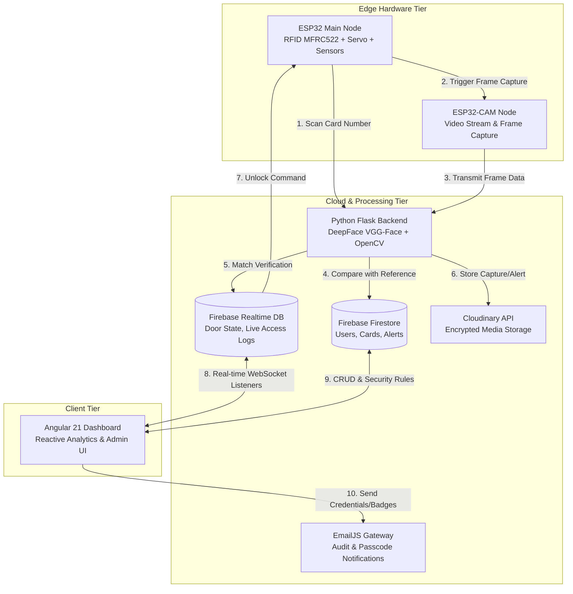

# 🛡️ SecureGate — Smart IoT Security & Biometric Access Control

[](https://angular.dev/)
[](https://www.python.org/)
[](https://flask.palletsprojects.com/)
[](https://firebase.google.com/)
[](https://www.espressif.com/)
[](LICENSE)

An enterprise-grade, distributed IoT security and smart access management ecosystem combining RFID badge authentication, deep learning facial verification, real-time telemetry, intrusion/tampering detection, and an administrative Progressive Web App (PWA) dashboard.

---

## 📌 Architecture Overview

SecureGate operates through three interconnected tiers:
1. **Edge Hardware Nodes (ESP32 & ESP32-CAM)**: Intercept physical access requests via RFID, capture surveillance imagery, control physical door locks via servo actuation, and monitor environmental tampering (PIR motion and vibration sensors).
2. **AI Inference & Security Backend (Python/Flask)**: Performs facial biometric verification via `DeepFace` (VGG-Face model), coordinates with Cloudinary media storage, logs events, and exposes REST endpoints.
3. **Web Management Dashboard (Angular 21)**: Provides real-time event monitoring, employee badge creation with dynamic QR codes and PDF export, user role management, system diagnostics, and push notifications.



---

## 🚀 Key Features

- **Multi-Factor Access Verification**: Two-step validation requiring both a valid registered RFID tag and facial biometric confirmation.
- **Biometric Face Verification**: Uses DeepFace with VGG-Face architecture to compare live captures against enrolled employee reference images.
- **Real-time Event Streaming**: Live telemetry updates via Firebase Realtime Database for instantaneous door status and audit logs.
- **Anti-Tampering & Intrusion Alerts**: Passive Infrared (PIR) motion thresholds and piezoelectric vibration detection detect forced entry or suspicious door loitering.
- **Vacation / Lockout Mode**: Individual or global access suspension with automatic high-priority intrusion logging when unauthorized entry is attempted.
- **Dynamic Digital ID Badge Generation**: HTML5 Canvas and `jsPDF` render professional vector badges with cryptographic QR codes, printable directly from the dashboard.
- **Secure Media Management**: Cloud-hosted access captures and avatars with server-side authorized deletion.

---

## 📂 Repository Directory Structure

```text
.
├── arduino/
│   ├── sketch_dec14b/                 # Main ESP32 sketch (RFID, Servo, PIR, LCD)
│   │   ├── sketch_dec14b.ino          # Core microcontroller logic
│   │   ├── config.h.example           # Wi-Fi & Firebase hardware template
│   │   └── config.h                   # (Local only, git-ignored)
│   ├── CameraWebServer/               # ESP32-CAM firmware
│   │   ├── CameraWebServer.ino        # Video capture & upload client
│   │   ├── camera_config.h.example    # Wi-Fi & backend URL template
│   │   └── camera_config.h            # (Local only, git-ignored)
│   └── libraries/                     # Arduino hardware driver libraries
├── backend/
│   ├── backend.py                     # Flask REST API & biometric verification
│   ├── requirements.txt               # Verified Python dependencies
│   ├── .env.example                   # Environment configuration template
│   ├── .env                           # (Local only, git-ignored)
│   └── firebase-service-account.example.json # Service account template
├── smart-iot-security/                # Angular 21 Standalone Web Application
│   ├── src/
│   │   ├── app/
│   │   │   ├── components/            # Dashboard, Users, Events, RFID, Settings
│   │   │   ├── config/                # Service configurations & templates
│   │   │   ├── models/                # TypeScript interfaces & models
│   │   │   └── services/              # AngularFire, Auth, Cloudinary services
│   ├── package.json                   # Node dependencies & scripts
│   └── angular.json                   # Angular CLI build workspace settings
├── .gitignore                         # Repository-wide Git exclusions
└── README.md                          # Project documentation
```

---

## ⚙️ Prerequisites & Versions

Ensure the following tools are installed on your environment:

| Technology | Minimum Version | Verified Version | Purpose |
|---|---|---|---|
| **Node.js** | `v18.x` | `v20.x` / `v22.x` | Frontend runtime |
| **npm** | `v9.x` | `v11.x` | Package manager |
| **Angular CLI** | `v17.x` | `v21.0.2` | Frontend build engine |
| **Python** | `3.10` | `3.11.9` | AI Backend runtime |
| **Arduino IDE** | `2.0+` | `2.3.x` | Hardware firmware compilation |
| **ESP32 Board Core** | `2.0.x` | `3.0.x` | Arduino ESP32 Board Manager |

---

## 🛠️ Step-by-Step Installation & Setup

### 1. Python AI Backend Setup

1. Open a terminal and navigate to the `backend/` directory:
   ```bash
   cd backend
   ```
2. Create and activate a Python virtual environment:
   ```bash
   # Windows PowerShell
   python -m venv .venv
   .\.venv\Scripts\Activate.ps1

   # Linux / macOS
   python3 -m venv .venv
   source .venv/bin/activate
   ```
3. Install the required dependencies:
   ```bash
   pip install -r requirements.txt
   ```
4. Configure environment variables:
   - Copy `.env.example` to `.env`:
     ```bash
     cp .env.example .env
     ```
   - Provide your Firebase Service Account JSON key (e.g. `service-account.json`) and configure `.env`:
     ```ini
     FIREBASE_PROJECT_ID=your-firebase-project-id
     FIREBASE_CREDENTIALS_PATH=service-account.json
     CLOUDINARY_CLOUD_NAME=your_cloud_name
     CLOUDINARY_API_KEY=your_api_key
     CLOUDINARY_API_SECRET=your_api_secret
     PORT=5000
     HOST=0.0.0.0
     ```
5. Launch the backend server:
   ```bash
   python backend.py
   ```
   *The server starts on `http://localhost:5000` with verification endpoints active.*

---

### 2. Angular Frontend Setup

1. Open a terminal and navigate to `smart-iot-security/`:
   ```bash
   cd smart-iot-security
   ```
2. Install npm dependencies:
   ```bash
   npm install
   ```
3. Configure frontend credentials:
   - Duplicate `src/app/config/firebase.config.example.ts` to `src/app/config/firebase.config.ts` and set your Firebase Web configuration:
     ```typescript
     export const firebaseConfig = {
       apiKey: "YOUR_FIREBASE_API_KEY",
       authDomain: "your-project.firebaseapp.com",
       databaseURL: "https://your-project-default-rtdb.firebaseio.com",
       projectId: "your-project",
       storageBucket: "your-project.firebasestorage.app",
       messagingSenderId: "...",
       appId: "..."
     };
     ```
   - Duplicate `src/app/config/cloudinary.config.example.ts` to `src/app/config/cloudinary.config.ts`:
     ```typescript
     export const cloudinaryConfig = {
       cloudName: 'YOUR_CLOUD_NAME',
       apiKey: 'YOUR_API_KEY',
       uploadPreset: 'YOUR_UNSIGNED_PRESET'
     };
     ```
   - Update `emailjs.config.ts` with your EmailJS service credentials.
4. Launch the Angular development server:
   ```bash
   npm start
   # or: ng serve
   ```
5. Open your browser and navigate to: **`http://localhost:4200`**

---

### 3. ESP32 & ESP32-CAM Firmware Setup

#### A. Main ESP32 Node (`arduino/sketch_dec14b/`)
1. Open `sketch_dec14b.ino` in Arduino IDE.
2. In the same directory, copy `config.h.example` to `config.h`.
3. Fill in your network SSID, Wi-Fi password, backend host IP, and Firebase Web credentials.
4. Connect your ESP32 board via USB, select board **ESP32 Dev Module**, and click **Upload**.

#### B. ESP32-CAM Node (`arduino/CameraWebServer/`)
1. Open `CameraWebServer.ino` in Arduino IDE.
2. Copy `camera_config.h.example` to `camera_config.h`.
3. Set your Wi-Fi credentials and point `BACKEND_URL` to your Python backend (e.g., `http://<your-backend-ip>:5000/verify-face`).
4. Select board **AI Thinker ESP32-CAM**, set partition scheme to **Huge APP (3MB No OTA / 1MB SPIFFS)**, and click **Upload**.

---

## 📡 API Endpoints Documentation

The Python Flask backend exposes the following REST API routes:

| Method | Endpoint | Headers / Params | Description |
|---|---|---|---|
| `GET` | `/health` | None | Service liveness probe. Returns `{"status": "OK"}`. |
| `GET` | `/check-rfid` | `?uid=<CARD_NUMBER>` | Queries Firestore for card registration and checks employee vacation mode status. |
| `POST` | `/verify-face` | Header: `X-RFID-UID` <br> Body: Raw image bytes (`image/jpeg`) | Runs DeepFace facial verification against the enrolled employee image, logs to RTDB, and updates door state. |
| `POST` | `/upload-image` | Form: `image` file, `uid` | Uploads security incident captures directly to Cloudinary. |
| `POST` | `/delete-image` | JSON: `{"public_id": "...", "resource_type": "image"}` | Secure server-side Cloudinary asset deletion (keeps API secret off client browsers). |

---

## 🔒 Security Best Practices

1. **Credential Segregation**: Real credentials must reside in local `.env`, `config.h`, and `camera_config.h` files. Never commit production credentials to version control.
2. **Client-Side Secret Shielding**: Public web clients must never possess write/delete master secrets (`CLOUDINARY_API_SECRET`, service account private keys, or reCAPTCHA secret keys). Privileged actions are handled exclusively via the Flask backend.
3. **Database Security Rules**: In production, deploy granular Firebase Security Rules to restrict unauthorized reads and writes:
   ```javascript
   rules_version = '2';
   service cloud.firestore {
     match /databases/{database}/documents {
       match /{document=**} {
         allow read, write: if request.auth != null;
       }
     }
   }
   ```
4. **Network Hardening**: Run the Flask backend and camera nodes on an isolated IoT VLAN when deployed in enterprise environments.

---

## 🧪 Testing & Build Verification

- **Backend Health Check**:
  ```bash
  curl http://localhost:5000/health
  ```
- **Frontend Production Build**:
  ```bash
  cd smart-iot-security
  npm run build
  ```
- **Linting & Unit Tests**:
  ```bash
  npm test
  ```

---

## 📄 License

This project is licensed under the MIT License — see the [LICENSE](LICENSE) file for details.
